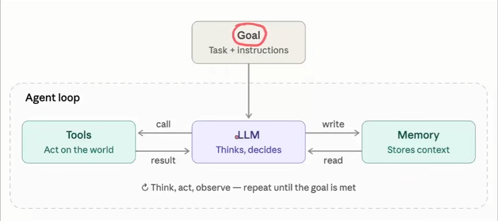
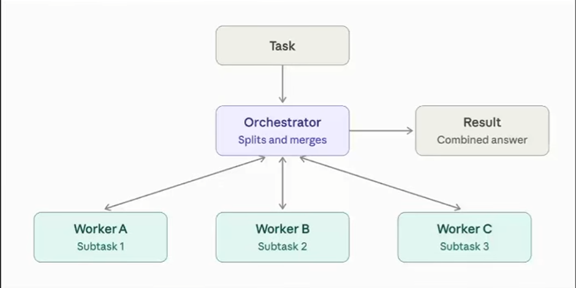
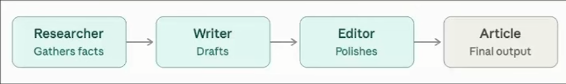
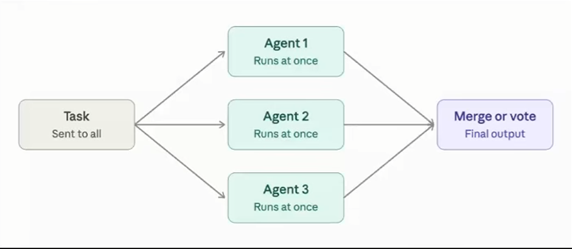
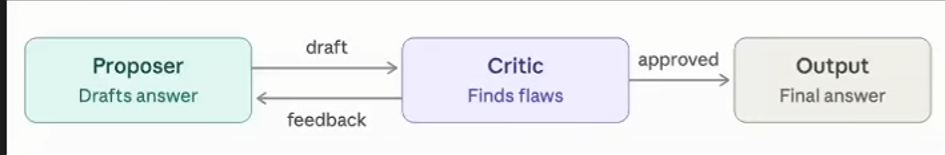
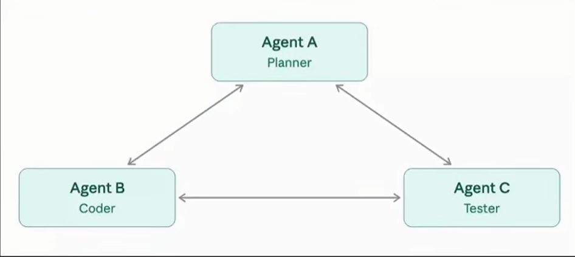
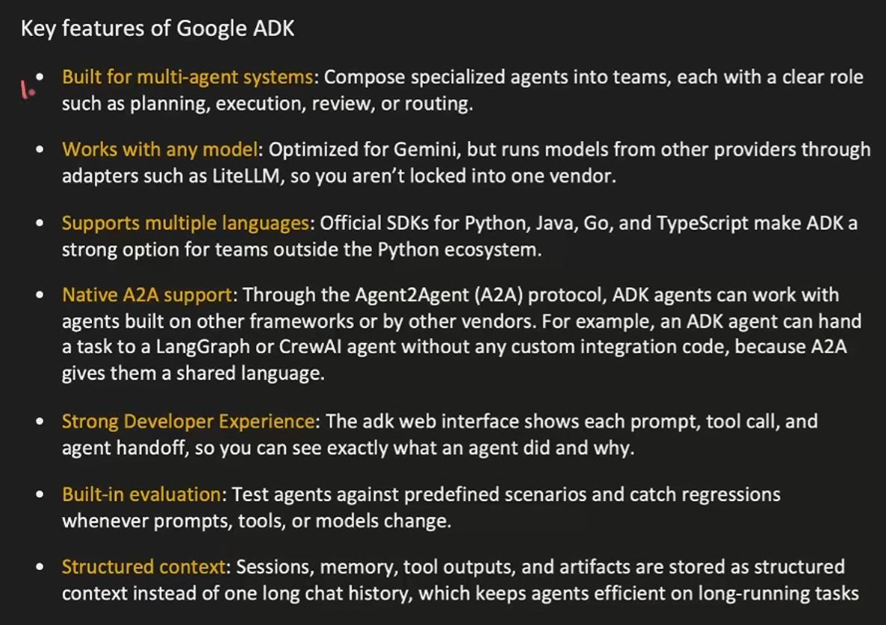
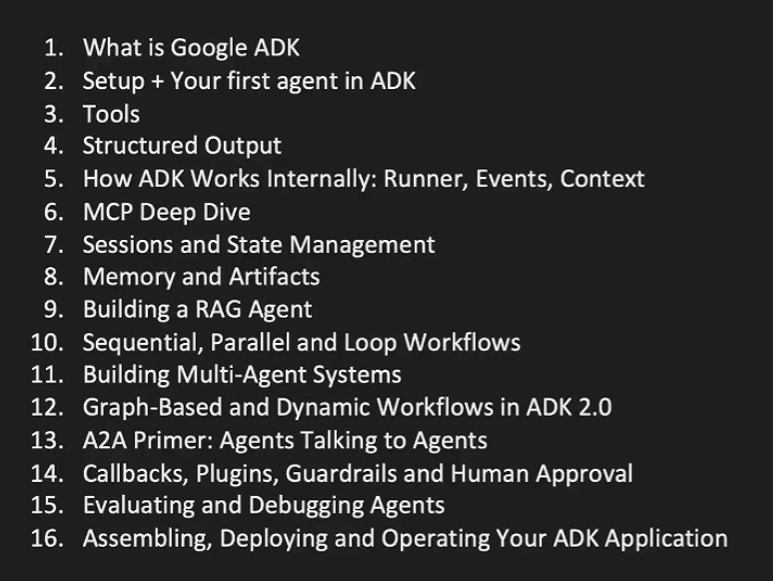

## Singel Agents
- An Agent is what you get when you late a model take action in a loop towards a goal - it decides what to do, does it, observes the result, and decides again, until the goal is met or it gives up

- three properties makes something an agent: 
1. Tool use: it can act on the world (search, call APIS, read/write files, run code) not just emit words
2. Autonomy over control flow : it decides the sequence of steps, rather than a developer hardcoding them, the path isn't known in advance.
3. Feedback loops: it observes the outcome of each action and adapts, so later steps depend on what earlier ones retured

## Multi Agent System
- A multi agent system is a setup where several AI agents work together to accomplish a task. each agents has its own LLM, tools, memory and loops but usually with a narrower role
- Instead of one agent doint everthing, the work in split up.
- For example, a coding system might have one agent that plans, one that writes code, one that test codes and one that reviews code

### Benifits of using more than one Agents
1. Focous: each agents gets a short, specific prompt and only the tools it needs so it performs better at its jobs
2. Context limit: a single agent context window fills up on big asks. subagents can each read a lot and return only a short summary
3. speed: independent subtasks can run in parallel
4. checks and balance: a seprate reviewer agents hasn't seen how the work was produced, so it judges the output more objectivily

### the trade offs
1. Complexity
2. Cost
3. Coordination problems
4. harder to debug

## Common Patterns
1. Orchestrator worker: a lead agent breaks the task into parts, hands each part to a worker agent, then combines the results. 

2. Pipeline(sequential): Agents pass work down a line, like an assembly line. each agents output become the next agents input

3. Parllel: Several Agents tackle different pieces, or the same piece, at the same time. their output are then merged, or put to a vote to pick the best one

4. debate or critique: one agent proposes and another critiques. they go back and forth until the critic satisfied, which catches mistakes a single agents would miss.

5. Peer collaboration: Agents talk to each other freely, with no single boss. this is flexible but harder to control, so it' less common in productions. 

## Curriculum
